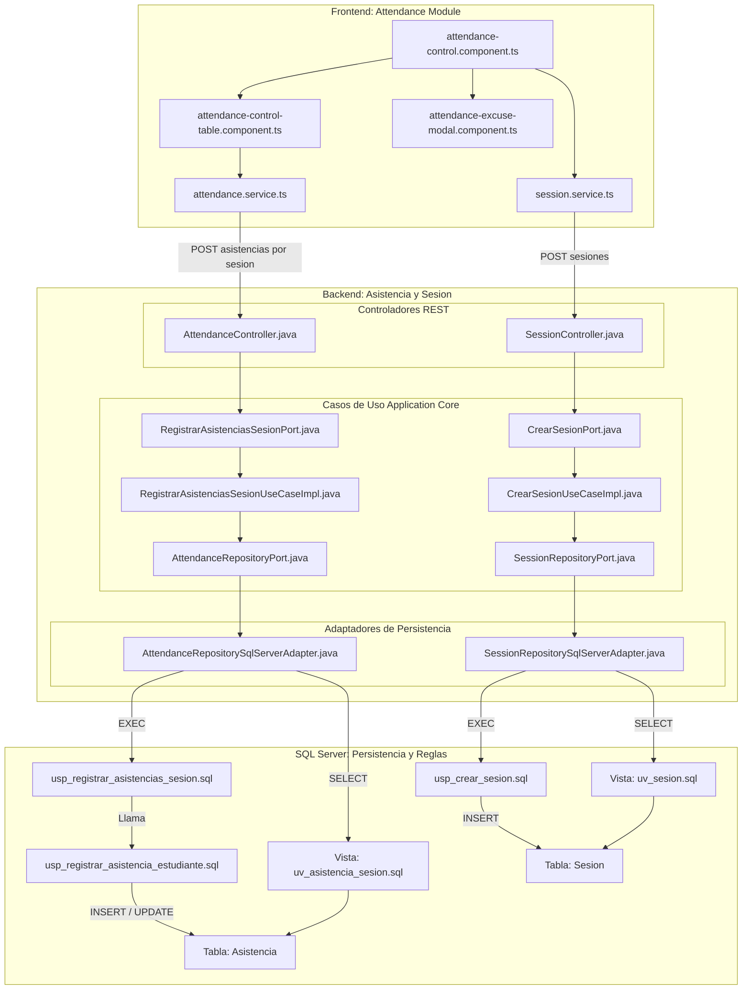
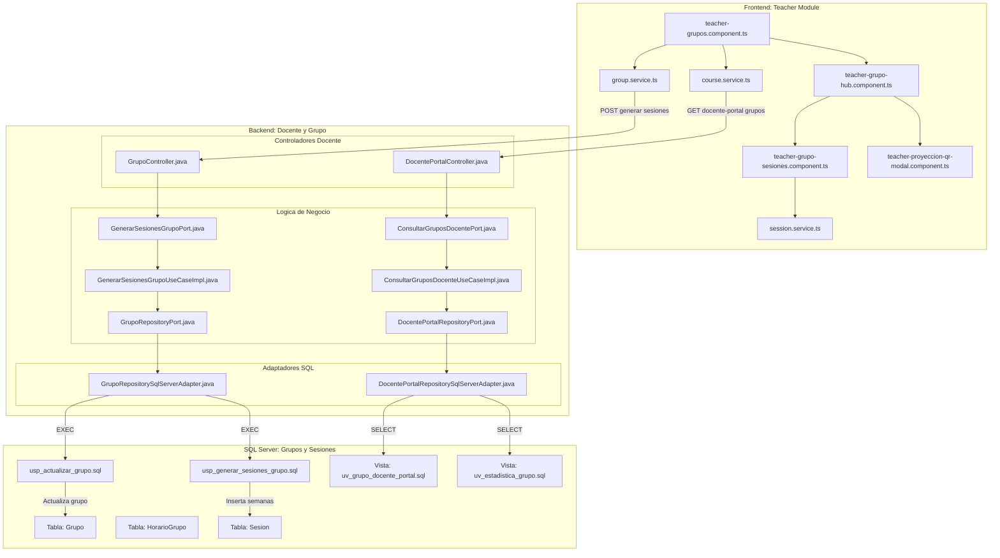
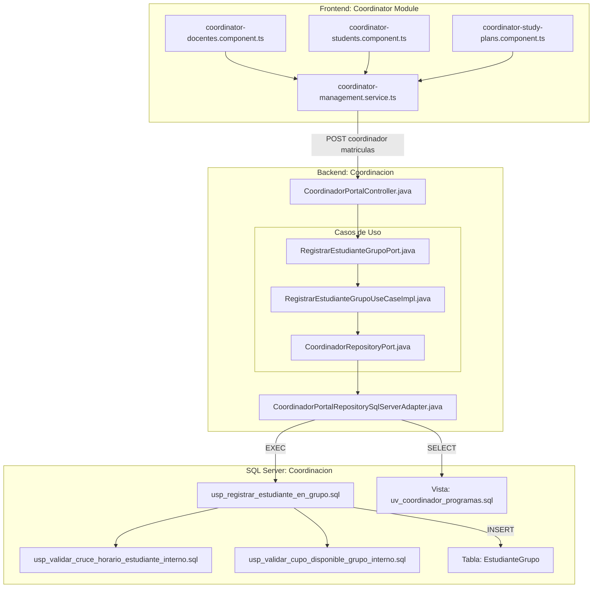
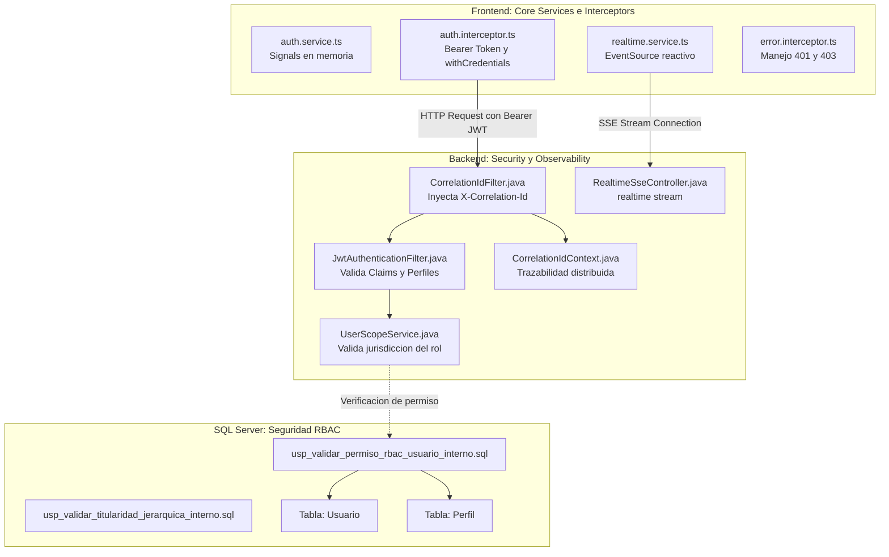

# 🗺️ Mapa de Relación de Archivos y Arquitectura End-to-End

Este documento detalla la interconexión y flujo de llamadas exacto entre los archivos de las 3 capas del ecosistema **Gestión de Asistencia UCO**:
1. **Frontend (Angular 19 / Signals)**
2. **Backend (Spring Boot 4 / Clean Architecture & Hexagonal)**
3. **Base de Datos (SQL Server 2022+ / Stored Procedures & Vistas)**

---

## 1. Visión Macro: Flujo Canónico Hexagonal

El sistema sigue de forma estricta el patrón de **Puertos y Adaptadores (Arquitectura Hexagonal)**. Toda interacción transaccional atraviesa las capas sin saltos indebidos ni dependencias circulares:

```mermaid
flowchart LR
    subgraph FRONTEND["Frontend Angular 19"]
        direction TB
        COMP["Componentes .component.ts<br/>OnPush y Signals"]
        SERV["Servicios *.service.ts<br/>HttpClient"]
        COMP --> SERV
    end

    subgraph BACKEND["Backend Spring Boot 4.0.6"]
        direction TB
        subgraph INFRA_IN["Infrastructure - Primary"]
            CTRL["Controller.java<br/>RestController"]
        end

        subgraph CORE["Application Core"]
            PORT_IN["PrimaryPort Port.java<br/>Contrato Entrada"]
            UC["UseCaseImpl.java<br/>Lógica de Negocio"]
            PORT_OUT["SecondaryPort Port.java<br/>Contrato Persistencia"]
            
            PORT_IN --> UC
            UC --> PORT_OUT
        end

        subgraph INFRA_OUT["Infrastructure - Secondary"]
            REPO["RepositorySqlServer*Adapter.java<br/>Spring Data JPA / JDBC legacy"]
        end

        CTRL --> PORT_IN
        PORT_OUT --> REPO
    end

    subgraph DB["Base de Datos SQL Server"]
        direction TB
        SP["Stored Procedures usp_*<br/>Transaccionalidad y ACID"]
        VISTA["Vistas uv_*<br/>Lecturas consolidadas"]
        TABLA["Tablas Físicas<br/>DDL"]
        
        SP --> TABLA
        VISTA --> TABLA
    end

    SERV -->|HTTP REST JSON| CTRL
    REPO -->|EXEC usp_*| SP
    REPO -->|SELECT uv_*| VISTA
```

---

## 2. Diagrama Detallado: Módulo de Asistencias y Control de Sesión

Este módulo gestiona la toma de asistencia manual, el registro de novedades, el auto-registro de estudiantes y la justificación de inasistencias.

---

## 3. Diagrama Detallado: Módulo de Docente y Gestión de Grupos

Mapea la administración de grupos, generación de sesiones semanales, proyección de códigos QR dinámicos y reportes de sábana.

---

## 4. Diagrama Detallado: Módulo de Coordinación y Matrícula

Mapea la administración de programas, asignaturas, matrícula de alumnos y validaciones de cruce de horario.

---

## 5. Diagrama Detallado: Autenticación, Seguridad y Realtime SSE

Muestra la sincronización de sesión, validación de JWT, suscripción reactiva a Server-Sent Events y trazabilidad OTLP.

---

## 6. Convenciones de Nomenclatura del Sistema

| Capa | Artefacto | Convención de Nombre | Ejemplo Real |
| :--- | :--- | :--- | :--- |
| **Frontend** | Componente UI | `<nombre>.component.ts` | `attendance-control.component.ts` |
| **Frontend** | Servicio API | `<entidad>.service.ts` | `attendance.service.ts` |
| **Backend** | Controlador REST | `<Entidad>Controller.java` | `AttendanceController.java` |
| **Backend** | Puerto Primario | `<Accion><Entidad>Port.java` | `RegistrarAsistenciasSesionPort.java` |
| **Backend** | Caso de Uso | `<Accion><Entidad>UseCaseImpl.java` | `RegistrarAsistenciasSesionUseCaseImpl.java` |
| **Backend** | Puerto Secundario | `<Entidad>RepositoryPort.java` | `AttendanceRepositoryPort.java` |
| **Backend** | Adaptador SQL | `<Entidad>RepositorySqlServerAdapter.java` | `AttendanceRepositorySqlServerAdapter.java` |
| **DB** | Stored Procedure Público | `usp_<accion>_<entidad>.sql` | `usp_registrar_asistencias_sesion.sql` |
| **DB** | Stored Procedure Interno | `usp_<accion>_<entidad>_interno.sql` | `usp_validar_cupo_disponible_grupo_interno.sql` |
| **DB** | Vista Consolidada | `uv_<entidad>.sql` | `uv_asistencia_sesion.sql` |
| **DB** | Tabla Física | `<Entidad>.sql` (PascalCase) | `Asistencia.sql`, `Sesion.sql` |
