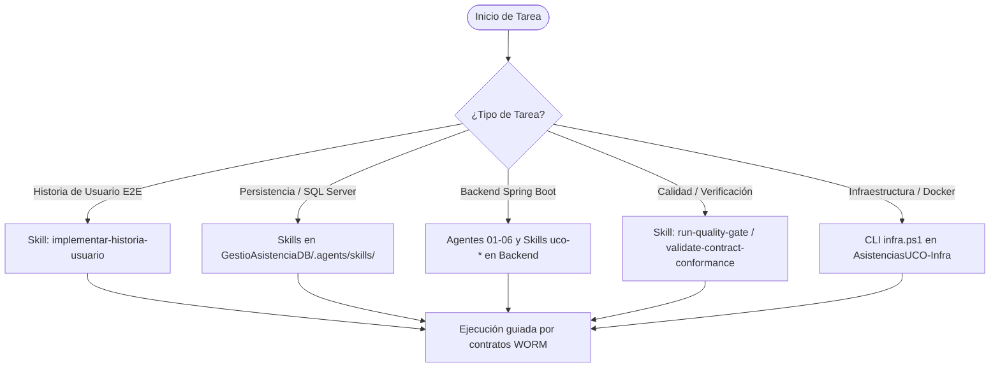

# 🤖 AGENTS_AND_SKILLS_INDEX.md — Catálogo Canónico de Agentes y Habilidades (Skills)

> **Ecosistema:** Sistema de Gestión de Asistencia UCO  
> **Ámbito:** Transversal (`GestioAsistencia`, `GestioAsistenciaDB`, `GestioAsistenciaBackend`, `GestioAsistenciaFrontend`, `AsistenciasUCO-Infra`)  
> **Tipo:** Normativo / Catálogo Operativo (`type: normative`, `status: active`)  
> **Propietario:** Equipo de Arquitectura y DevOps  
> **Última Revisión:** Octubre 2026  

---

## 1. Propósito y Principio de Distribución

Este documento constituye la **fuente única de verdad (SSOT)** que cataloga e indexa la totalidad de agentes especializados y habilidades (*skills*) disponibles en el ecosistema.

### 🏛️ Principio de Co-localización (Scope-Driven Placement)
Por razones de autodescubrimiento técnico en herramientas de IA (Antigravity, Gemini CLI, Claude Code) y principio de mínima exposición:
1. **Las habilidades NO deben moverse a una carpeta central de infraestructura.** Moverlas rompería las rutas relativas de invocación y el contexto nativo de cada capa.
2. **Infraestructura (`AsistenciasUCO-Infra`) actúa como registro maestro y referenciador:** Mantiene este índice actualizado con el propósito, ubicación física y ámbito de responsabilidad de cada activo.

---

## 2. Mapa Rápido de Ubicaciones

```text
c:\Proyectos\GestioAsistencia/
├── .agents/skills/                       # Skills transversales y globales de orquestación
├── GestioAsistenciaDB/
│   └── .agents/skills/                   # Skills especializadas en SQL Server 2022+
├── GestioAsistenciaBackend/
│   └── .claude/
│       ├── agents/                       # Agentes por fase del ciclo TDD (01 a 06)
│       └── skills/                       # Skills modulares de Spring Boot y Cloud
├── GestioAsistenciaFrontend/             # Consumidor de interfaces y contratos UI
└── AsistenciasUCO-Infra/
    └── docs/governance/
        └── AGENTS_AND_SKILLS_INDEX.md    # [ESTE CATÁLOGO MAESTRO]
```

---

## 3. Catálogo de Habilidades Transversales (Workspace Raíz)

Ubicación física: [`/.agents/skills/`](file:///c:/Proyectos/GestioAsistencia/.agents/skills/)

| Skill | Ámbito / Propósito | Archivo Principal |
| :--- | :--- | :--- |
| **`implementar-historia-usuario`** | Metodología y procedimiento estricto para implementar historias de usuario (HU001 a HU174) a través de las tres capas (DB, Backend, Frontend) garantizando no-regresión. | [`SKILL.md`](file:///c:/Proyectos/GestioAsistencia/.agents/skills/implementar-historia-usuario/SKILL.md) |
| **`run-quality-gate`** | Ejecuta la suite integral de Quality Gates (ArchUnit, JUnit 5 en Backend; Karma, Coverage y Build en Frontend). | [`SKILL.md`](file:///c:/Proyectos/GestioAsistencia/.agents/skills/run-quality-gate/SKILL.md) |
| **`validate-contract-conformance`**| Valida estricta conformidad entre contratos WORM (OpenAPI, DDL y Eventos SSE) y el código de implementación, previniendo drift antes de pruebas/merges. | [`SKILL.md`](file:///c:/Proyectos/GestioAsistencia/.agents/skills/validate-contract-conformance/SKILL.md) |
| **`analizar-estado-proyecto`** | Auditoría técnica continua: antipatrones, hardcoding, fugas de lógica, desincronización de esquemas y deuda técnica. | [`SKILL.md`](file:///c:/Proyectos/GestioAsistencia/.agents/skills/analizar-estado-proyecto/SKILL.md) |
| **`auditar-frontend-ux-arquitectura`** | Auditoría profunda de UX/UI y arquitectura Frontend (Angular 19, Signals, Standalone, OnPush, SSE, Tailwind). | [`SKILL.md`](file:///c:/Proyectos/GestioAsistencia/.agents/skills/auditar-frontend-ux-arquitectura/SKILL.md) |
| **`deploy-and-verify-db-schema`** | Compila el esquema DDL relacional en SQL Server (Docker) y ejecuta la suite transaccional verificando cero transacciones huérfanas. | [`SKILL.md`](file:///c:/Proyectos/GestioAsistencia/.agents/skills/deploy-and-verify-db-schema/SKILL.md) |

---

## 4. Catálogo de Habilidades de Base de Datos (`GestioAsistenciaDB`)

Ubicación física: [`/GestioAsistenciaDB/.agents/skills/`](file:///c:/Proyectos/GestioAsistencia/GestioAsistenciaDB/.agents/skills/)

| Skill | Ámbito / Propósito | Archivo Principal |
| :--- | :--- | :--- |
| **`procedimientos-externos-condiciones`** | Reglas estructurales y de contrato para procedimientos almacenados públicos u orquestadores (`usp_*`). | [`SKILL.md`](file:///c:/Proyectos/GestioAsistencia/GestioAsistenciaDB/.agents/skills/procedimientos-externos-condiciones/SKILL.md) |
| **`procedimientos-internos-condiciones`** | Reglas estructurales atómicas para procedimientos almacenados internos (`usp_*_interno`). | [`SKILL.md`](file:///c:/Proyectos/GestioAsistencia/GestioAsistenciaDB/.agents/skills/procedimientos-internos-condiciones/SKILL.md) |
| **`vista-consulta-con-validaciones`** | Estándar y especificación para vistas autorizadas (`uv_auth_*`) con control de rol y aislamiento de dominio. | [`SKILL.md`](file:///c:/Proyectos/GestioAsistencia/GestioAsistenciaDB/.agents/skills/vista-consulta-con-validaciones/SKILL.md) |
| **`consulta-a-bd`** | Estándar obligatorio de lecturas a BD exigiendo uso de Vistas (`uv_*`) y prohibiendo lecturas directas a tablas físicas. | [`SKILL.md`](file:///c:/Proyectos/GestioAsistencia/GestioAsistenciaDB/.agents/skills/consulta-a-bd/SKILL.md) |
| **`consistencia-tablas`** | Salvaguarda estructural e integridad de esquema físico para tablas de dominio. | [`SKILL.md`](file:///c:/Proyectos/GestioAsistencia/GestioAsistenciaDB/.agents/skills/consistencia-tablas/SKILL.md) |
| **`modelo-jerarquico-rbac`** | Estándar canónico del modelo jerárquico de custodia, delimitación de dominios y matriz RBAC en SQL Server. | [`SKILL.md`](file:///c:/Proyectos/GestioAsistencia/GestioAsistenciaDB/.agents/skills/modelo-jerarquico-rbac/SKILL.md) |
| **`cobertura-pruebas-objetos-bd`** | Estándar de cobertura de pruebas unitarias T-SQL (Happy Path, Edge Cases, Errores y Roles) para todo objeto modificado. | [`SKILL.md`](file:///c:/Proyectos/GestioAsistencia/GestioAsistenciaDB/.agents/skills/cobertura-pruebas-objetos-bd/SKILL.md) |

---

## 5. Catálogo de Agentes y Habilidades de Backend (`GestioAsistenciaBackend`)

### 5.1 Agentes de Ciclo TDD por Fases
Ubicación física: [`/GestioAsistenciaBackend/.claude/agents/`](file:///c:/Proyectos/GestioAsistencia/GestioAsistenciaBackend/.claude/agents/)

| Agente / Rol | Fase | Responsabilidad Primaria |
| :--- | :---: | :--- |
| **`01-planificador.md`** | 01 | Análisis de requerimiento, definición de alcance, verificación de DoR (`Definition of Ready`) y creación del plan en el work-item. |
| **`02-contratos.md`** | 02 | Formalización y congelamiento de contratos OpenAPI, JDBC/SP o eventos SSE antes de codificar. |
| **`03-tester-red.md`** | 03 | Redacción de pruebas que fallan (TDD RED) a partir de los contratos definidos. Pruebas inviolables por el implementador. |
| **`04-implementador.md`** | 04 | Implementación del código de producción bajo Clean Architecture para poner las pruebas en verde (GREEN). |
| **`05-auditor.md`** | 05 | Auditoría independiente de calidad, reglas de arquitectura, cobertura JaCoCo y detección de regresiones. |
| **`06-cierre.md`** | 06 | Verificación de DoD (`Definition of Done`), actualización de línea base y registro formal de cierre del work-item. |

### 5.2 Skills Técnicos Especializados
Ubicación física: [`/GestioAsistenciaBackend/.claude/skills/`](file:///c:/Proyectos/GestioAsistencia/GestioAsistenciaBackend/.claude/skills/)

| Skill | Ámbito Técnico |
| :--- | :--- |
| **`uco-arquitectura`** | Capas Clean Architecture, puertos primarios/secundarios, interactors e inyección de dependencias. |
| **`uco-baseline`** | Gestión de fases de línea base, Golden Path, matriz de deuda técnica y reglas de cierre. |
| **`uco-contratos`** | Manejo de contratos HTTP OpenAPI, esquemas `ApiDataResponse<T>`, `ApiPageResponse<T>` y catálogos de error. |
| **`uco-persistencia`** | Persistencia Spring Data JPA, adaptadores JDBC legacy y mapeo de tuplas de stored procedures. |
| **`uco-testing`** | Estrategia de pruebas RED, JaCoCo (Line ≥80%, Branch ≥70%), ArchUnit y pruebas de integración controladas. |
| **`uco-seguridad`** | Autenticación OAuth2/OIDC con Keycloak, validación de JWT, roles institucionales y `UserScopeService`. |
| **`uco-observabilidad`** | Trazas OpenTelemetry (OTLP), `CorrelationIdContext`, logs estructurados JSONL y métricas Prometheus. |
| **`uco-realtime`** | Transmisión de eventos de servidor (SSE) en `/api/v1/realtime/stream` y reactividad sin polling. |
| **`uco-catalogos`** | Consumo y fallback de catálogos dinámicos (`MessageCatalogPort` y `ParameterCatalogPort`). |
| **`uco-azure`** | Integración con Azure App Configuration, Azure Key Vault y Event Grid. |
| **`uco-files`** | Carga de adjuntos, integración con ClamAV daemon y almacenamiento compatible con MinIO/S3. |
| **`uco-quality-gate`** | Reglas de calidad para Pull Requests, SonarCloud y mitigación de vulnerabilidades CodeQL. |
| **`uco-backend-pagination-utc`** | Convenciones de paginación basada en índices 0/1 y manejo uniforme de fechas en zona horaria UTC. |

---

## 6. Guía de Selección para Agentes y Desarrolladores

Cuando abordes una tarea en el proyecto, identifica el dominio y carga las herramientas correspondientes:


