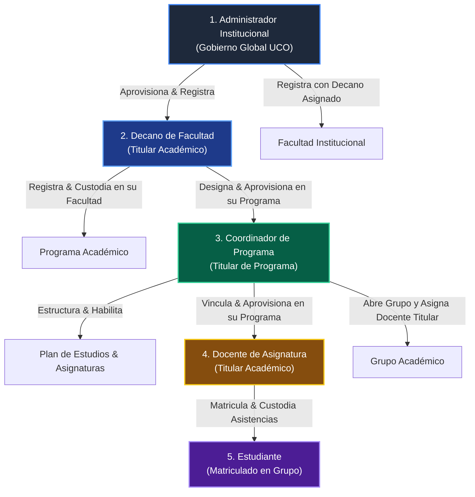

# 🗺️ Hoja de Ruta y Precedencia: Registro Jerárquico de Roles Institucionales
> **Ecosistema:** Sistema de Gestión de Asistencia UCO  
> **Ámbito:** Administración, Decanatura, Coordinación y Docencia  
> **Objetivo:** Definir el orden estricto de precedencia, dependencias y catálogo de Historias de Usuario (HUs) para la gobernanza jerárquica de roles sin superusuarios monolíticos.

---

## 🏛️ 1. Principio Institucional de Custodia y Delimitación Jerárquica

En el Sistema de Asistencias UCO, **ningún rol puede realizar todas las operaciones**. Se implementa un principio estricto de **Custodia Jerárquica y Mínimo Privilegio (RBAC)**:



### Reglas de Delimitación Inviolables:
1. **Administrador:** Aprovisiona Decanos titulares y registra Facultades vinculando obligatoriamente a su Decano responsable (conforme a la restricción `[decano] NOT NULL` e integridad referencial en base de datos). No gestiona materias, grupos ni docentes individuales.
2. **Decano:** Solo opera dentro de su **Facultad** asignada (`UserScopeService.resolveFacultadId()`). Da de alta Programas y designa a sus Coordinadores.
3. **Coordinador:** Solo opera dentro de su **Programa Académico** (`UserScopeService.resolveProgramaId()`). Crea asignaturas, vincula docentes y abre grupos académicos asignando docentes titulares.
4. **Docente:** Solo opera sobre los **Grupos donde es titular**. Es el **único** que puede registrar asistencias, justificaciones y matricular/retirar alumnos de su curso.
5. **Estudiante:** Accede exclusivamente en modo consulta a sus asignaturas matriculadas y radica solicitudes de justificación.

---

## 📊 2. Matriz de Historias de Usuario por Nivel Jerárquico

A continuación se presenta el catálogo consolidado de HUs vinculadas al registro y gestión de roles, con su estado en la línea base:

| Nivel | Rol Gestor | Entidad / Rol Registrado | Código HU | Título de la Historia de Usuario | Estado Actual |
| :--- | :--- | :--- | :--- | :--- | :--- |
| **0** | *Sistema* | Catálogos Base (Tipos ID, Programas, Áreas) | **HU022 / HU153** | Catálogo: Tipos de Identificación | `[CERTIFICADA]` |
| **0** | *Sistema* | Tipos de Programa Académico | **HU023 / HU154** | Catálogo: Modalidades y Tipos de Programa | `[PARCIAL]` |
| **0** | *Sistema* | Institución Universitaria (UCO) | **HU163** | Consulta de Institución | `[CERTIFICADA]` |
| **1** | **Administrador** | **Decano** (Directorio institucional) | **HU137 / Portal** | Directorio administrativo y consulta de Decanos (`GET /admin/decanos`) | `[CERTIFICADA]` |
| **1** | **Administrador** | **Decano** (Alta y aprovisionamiento IAM) | **HU117-B (Nueva)** | Registrar Decano titular y sincronizar cuenta IAM (`POST /admin/decanos` / `usp_crear_decano`) | `[CERTIFICADA]` |
| **1** | **Administrador** | **Facultad** (Estructura física y académica) | **HU107** | Consultar estructura institucional de facultades | `[CERTIFICADA]` |
| **1** | **Administrador** | **Facultad** (Alta con Decano asignado) | **HU116** | Alta institucional de nueva facultad (`usp_crear_facultad`, requiere Decano titular) | `[CERTIFICADA]` |
| **1** | **Administrador** | **Facultad** (Modificación y estado) | **HU110 / HU111** | Modificar denominación y alternar estado de facultad | `[BLOQUEADO 501]` |
| **1** | **Administrador** | **Decano** (Reasignación de titularidad) | **HU117** | Modificar sede y decano responsable de facultad | `[BLOQUEADO 501]` |
| **2** | **Decano** | **Programa Académico** (Apertura) | **HU076** | Agregar nuevo programa académico a la facultad | `[PENDIENTE]` |
| **2** | **Decano** | **Programa Académico** (Modificación) | **HU077 / HU078** | Modificar datos y alternar estado de programa | `[PENDIENTE]` |
| **2** | **Decano** | **Coordinador** (Directorio y Búsqueda) | **HU124 / HU123** | Directorio y búsqueda predictiva de coordinadores | `[CERTIFICADA]` |
| **2** | **Decano** | **Coordinador** (Creación y Asignación) | **HU120** | Crear y asignar Coordinador a Programa | `[CERTIFICADA]` |
| **2** | **Decano** | **Coordinador** (Modificación y Estado) | **HU121 / HU122** | Actualizar información y alternar estado activo/inactivo | `[PENDIENTE / 501]` |
| **3** | **Coordinador** | **Planes de Estudio y Asignaturas** | **HU079 / HU085** | Crear plan de estudio y crear asignaturas del programa | `[CERTIFICADA]` |
| **3** | **Coordinador** | **Docente** (Directorio de profesores) | **HU062 / HU089** | Directorio de profesores adscritos al programa | `[BLOQUEADO 501]` |
| **3** | **Coordinador** | **Docente** (Alta y Vinculación) | **HU091** | Vincular docente al programa y sincronizar IAM | `[BLOQUEADO 501]` |
| **3** | **Coordinador** | **Docente** (Edición y Estado) | **HU092 / HU093** | Modificar datos profesionales y alternar estado docente | `[BLOQUEADO 501]` |
| **3** | **Coordinador** | **Grupo Académico** (Apertura y Asignación Docente) | **HU076B** | Creación de grupo académico con docente titular asignado | `[CERTIFICADA]` |
| **4** | **Docente** | **Estudiante** (Matrícula en Grupo) | **HU050** | Matrícula manual de estudiante por docente en grupo titular | `[CERTIFICADA]` |
| **4** | **Docente** | **Asistencia** (Control de Sesiones) | **HU027 – HU040** | Registro en vivo de asistencia y justificaciones | `[CERTIFICADA]` |

---

## 🚦 3. Grafo de Dependencias y Orden de Ejecución Recomendado

Para construir la estructura sin bloqueos, se debe seguir la siguiente **secuencia de 4 etapas progresivas**:

```text
┌─────────────────────────────────────────────────────────────────────────────┐
│ ETAPA 1: CUSTODIA DE DECANATURA (Administrador ➔ Decano ➔ Facultad)         │
│ 1.1 HU117-B: Alta de Usuario Decano y Aprovisionamiento IAM (POST /decanos) │
│ 1.2 HU116: Alta de Facultad vinculando Decano Titular (POST /facultades)    │
│ 1.3 HU117: Modificar sede y reasignar decano responsable de facultad        │
│ 1.4 HU110 / HU111: Modificación de atributos y switch de estado de Facultad │
└──────────────────────────────────────┬──────────────────────────────────────┘
                                       │ Permite iniciar sesión como Decano
                                       ▼
┌─────────────────────────────────────────────────────────────────────────────┐
│ ETAPA 2: CUSTODIA DE COORDINACIÓN (Decano ➔ Programa ➔ Coordinador)         │
│ 2.1 HU076: Alta de Programa Académico en Facultad (usp_crear_programa)     │
│ 2.2 HU078: Switch de vigencia/estado del Programa                           │
│ 2.3 HU120: Crear y asignar Coordinador al Programa (Consolidar y Auditar)  │
│ 2.4 HU121 / HU122: Edición y activación/suspensión de Coordinador          │
└──────────────────────────────────────┬──────────────────────────────────────┘
                                       │ Permite iniciar sesión como Coordinador
                                       ▼
┌─────────────────────────────────────────────────────────────────────────────┐
│ ETAPA 3: CUSTODIA DOCENTE (Coordinador ➔ Docentes ➔ Apertura de Grupos)      │
│ 3.1 HU062 / HU089: Desbloquear Directorio de Docentes (GET /docentes)       │
│ 3.2 HU091: Vincular Docente al Programa y Sincronizar Cuenta IAM Keycloak   │
│ 3.3 HU092 / HU093: Actualizar perfil profesional y alternar estado docente  │
│ 3.4 HU076B: Apertura de Grupos asignando al Docente recién vinculado        │
└──────────────────────────────────────┬──────────────────────────────────────┘
                                       │ Permite al Docente gestionar su curso
                                       ▼
┌─────────────────────────────────────────────────────────────────────────────┐
│ ETAPA 4: CUSTODIA ESTUDIANTIL & SESIONES (Docente ➔ Alumnos ➔ Asistencias) │
│ 4.1 HU050 / Matrícula: Registrar alumnos en el grupo (Completado y OK)      │
│ 4.2 HU027 - HU040: Toma de asistencia en tiempo real y cálculo del 20%      │
└─────────────────────────────────────────────────────────────────────────────┘
```

---

## 🎯 4. Estado de Avance y Próximo Paso Recomendado

### 4.1 Hitos Alcanzados en Etapa 1:
- [x] **`HU117-B: Alta de Decano y Aprovisionamiento IAM`**: `[CERTIFICADA]` (Decano institucional aprovisionado en persistencia y Keycloak).
- [x] **`HU116: Alta institucional de nueva Facultad`**: `[CERTIFICADA]` (Persistencia DDL con `usp_crear_facultad`, Backend REST en `/api/v1/admin/facultades` con Clean Architecture, Decano obligatorio y UI reactiva en Angular con Signals).

### 4.2 Próximo Paso Inmediato en la Jerarquía Institucional:
Para continuar con la construcción jerárquica de la universidad:
👉 **Paso Inmediato (Etapa 2 - Custodia de Coordinación):**
- **`HU076: Alta de Programa Académico en Facultad`** (`usp_crear_programa` / `POST /api/v1/decano/programas`), permitiendo al Decano titular de la Facultad crear programas académicos oficiales bajo su jurisdicción.
- Alternativamente, si se requiere ajustar la custodia de la facultad antes de crear programas: **`HU117: Modificar sede y decano responsable de facultad`**.
